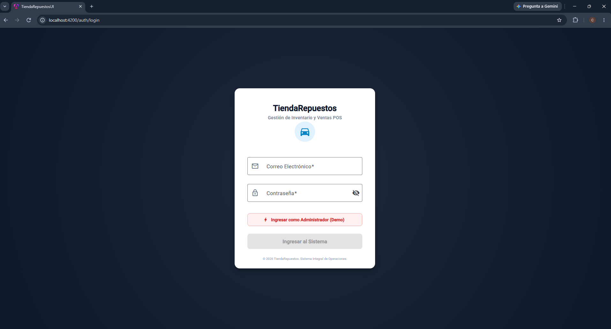
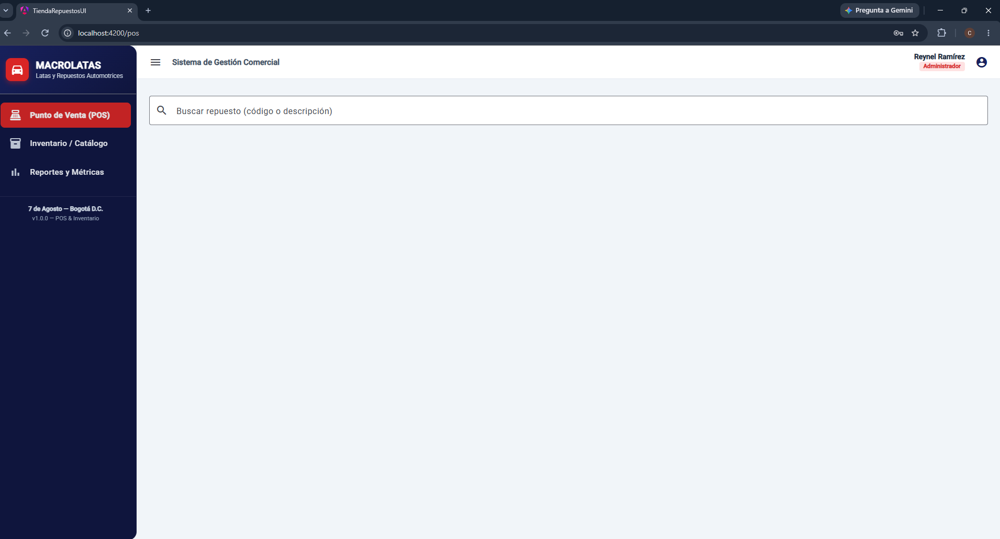
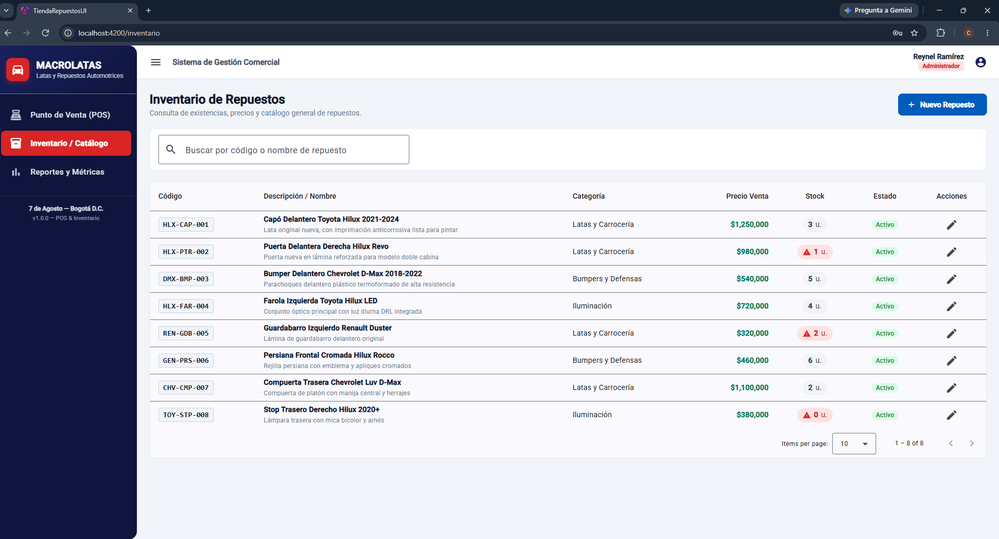

# 🚗 TiendaRepuestos-UI — Sistema POS e Inventario Automotriz

Frontend SPA empresarial para la gestión integral de repuestos de carrocería, latas, iluminación y facturación en mostrador para **MACROLATAS**.

Desarrollado con **Angular 19 Standalone**, **Angular Material**, **TypeScript Estricto** y arquitectura de **Puertos y Adaptadores (Hexagonal)**, totalmente integrado con backend en **.NET 8 (Clean Architecture)** y especificación de errores **RFC 7807**.

---

## 📸 Vitrina del Sistema (Showcase)

### 1. Autenticación y Control de Acceso (RBAC)
Acceso seguro con token JWT, validación de expiración en tiempo real y soporte para roles `Administrador` y `Vendedor`.


### 2. Punto de Venta (POS) y Caja Reactiva
Búsqueda optimizada con retardo reactivo (`debounceTime`), control estricto de existencias en mostrador y ticket de venta en memoria con Signals.


### 3. Catálogo y Control de Inventario
Tabla de existencias con alertas visuales inmediatas para stock por debajo del umbral mínimo y paginación server-side.


---

## 🛠️ Stack Tecnológico

* **Framework:** Angular 19 (Standalone Components, Signals reactivos, Zoneless ready).
* **Biblioteca UI:** Angular Material (M3 components, MatTable, MatPaginator, MatDialog).
* **Gestión de Estado:** Angular Signals y Computed Properties para reactividad de grano fino.
* **Programación Asíncrona:** RxJS (Debounce, distinctUntilChanged, flujos HTTP).
* **Estilos:** SCSS modularizado preparado para tematización CSS Custom Properties.
* **Arquitectura:** Core / Features / Shared estructurado bajo Puertos y Adaptadores.

---

## 🏗️ Arquitectura de Software (Puertos y Adaptadores)

Para desacoplar el desarrollo del Frontend de la disponibilidad del Backend, la aplicación implementa Inversión de Dependencias (DI) mediante contratos abstractos:

```text
src/app/core/services/
├── auth/
│   ├── auth.service.ts         (Puerto Abstracto)
│   ├── auth-http.service.ts    (Adaptador Real .NET 8)
│   └── auth-mock.service.ts    (Adaptador Mock Local)
├── productos/
│   ├── producto.service.ts
│   ├── producto-http.service.ts
│   └── producto-mock.service.ts
└── ventas/
    ├── venta.service.ts
    ├── venta-http.service.ts
    └── venta-mock.service.ts

Conmutación Rápida de Entorno
En src/environments/environment.development.ts:

useMocks: true ➔ Ejecución autónoma con base de datos en memoria para diseño y pruebas.

useMocks: false ➔ Conexión directa contra Web API .NET 8 en https://localhost:7298/api.

🚀 Puesta en Marcha Local
Prerrequisitos
Node.js v20+ o v22+

Angular CLI v19 (npm install -g @angular/cli)

Instalación y Ejecución
Bash
# 1. Clonar el repositorio
git clone [https://github.com/tu-usuario/TiendaRepuestos-UI.git](https://github.com/tu-usuario/TiendaRepuestos-UI.git)

# 2. Instalar dependencias
npm install

# 3. Iniciar servidor de desarrollo
ng serve
Navega a http://localhost:4200/. El navegador recargará automáticamente la aplicación ante cualquier cambio en el código fuente.

📌 Hoja de Ruta (Roadmap)
[x] Arquitectura base, Interceptores (JWT / RFC 7807) y Signals de sesión.

[x] Route Guards funcionales para RBAC (authGuard, roleGuard, publicGuard).

[x] Shell Layout responsivo con identidad corporativa de MACROLATAS.

[x] Caja POS reactiva con cálculo financiero instantáneo y validación de stock.

[x] Catálogo de inventario con paginación y alertas de stock crítico.

[ ] Modal interactivo (MatDialog) para creación y edición de repuestos.

[ ] Dashboard gerencial de reportes (Top más vendidos y déficit de inventario).

[ ] Configuración como Progressive Web App (PWA) para instalación en dispositivos móviles.

📄 Licencia
Proyecto privado desarrollado para MACROLATAS — 7 de Agosto, Bogotá D.C. © 2026.
